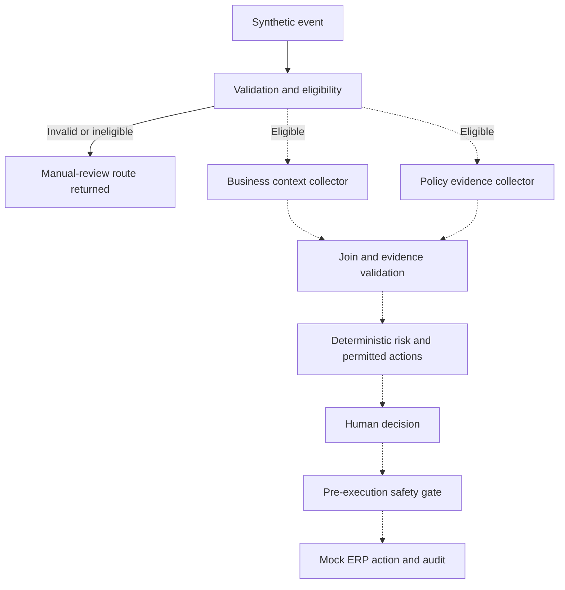

# Agentic Order Exception Workflow

An enterprise AI proof of concept under active development for reviewing credit-blocked B2B sales orders.

**Current implementation:** input validation, deterministic eligibility, three synthetic scenarios and 11 test methods. Context collection, retrieval, risk evaluation, human review and execution are designed but not implemented. No LLM, live ERP connection or financial action is included.

## Business problem

A credit block identifies an exception without providing the information needed to resolve it. A reviewer must combine payment history, commercial context, credit policy and contractual restrictions before deciding whether an exception is justified.

The target workflow collects this evidence, calculates risk using explicit rules and prepares a recommendation. An authorised human must approve any action; the system must never autonomously release an order.

## Quick start

Use Python 3.9 or later from the repository root. There are no third-party dependencies or API keys.

```bash
PYTHONPATH=src python3 -m order_exception
PYTHONPATH=src python3 -m unittest discover -s tests -v
```

The CLI reads `data/blocked_orders.json` and prints eligibility results:

| Order | Input | Expected outcome |
| --- | --- | --- |
| ORD-DEMO-001 | EUR 120,000; credit block; no hard stop | Eligible for context collection |
| ORD-DEMO-002 | EUR 180,000; hard stop present | Valid but ineligible; manual review |
| ORD-DEMO-003 | EUR 160,000; unknown hard stop | Validation failed; manual review |

An eligible result is admission to analysis, not approval to release. These are expected results derived from the code; see the test command for executable checks.

## Architecture

Solid arrows describe the implemented eligibility path. Dotted arrows describe planned transitions.



The current CLI returns route labels; it does not invoke collectors or provide a manual-review interface. [Full decision flow](docs/decision-flow.md) includes failures, information requests and execution reconciliation.

## Design principles

- Keep eligibility, risk, authority and execution checks deterministic.
- Treat missing facts as unknown; never substitute favourable defaults.
- Constrain actions by the intersection of credit policy and contract permissions.
- Bind approval to the assessed facts; material changes require reassessment.
- Use LLMs only for evidence assistance and explanations, with validated outputs.
- Preserve source evidence, decisions and execution outcomes in a case audit trail.

Only the eligibility controls are enforced by the current code.

## Technology and structure

Python standard library: `dataclasses`, `decimal`, `json` and `unittest`. LangGraph, retrieval storage, an LLM provider and a review interface are future choices, not dependencies.

| Path | Purpose |
| --- | --- |
| `src/order_exception/eligibility.py` | Implemented validation and eligibility rules |
| `src/order_exception/__main__.py` | Synthetic eligibility demo |
| `data/blocked_orders.json` | Three synthetic ERP events |
| `tests/test_eligibility.py` | Boundary and invalid-input tests |
| [Architecture](docs/architecture.md) | Components, interfaces and implementation status |
| [Decision flow](docs/decision-flow.md) | End-to-end target workflow |
| [Guardrails](docs/guardrails.md) | Controls, enforcement and failure behaviour |
| [Architecture decisions](docs/decisions.md) | Trade-offs and open decisions |
| [State contract](docs/state-contract.md) | Current results and target case lifecycle |

## Next implementation increments

1. Validated synthetic ERP/CRM context and deterministic risk tests.
2. Versioned synthetic policy, contract and SOP evidence; permitted-action intersection.
3. Case orchestration, simulated human review and approval invalidation.
4. Mock execution, idempotency, reconciliation and audit scenarios.
5. Optional retrieval and LLM integration, evaluated against the offline baseline.

## Limitations

This is not yet an end-to-end agentic demo. There is no persistent case registry, deduplication, RAG, LLM integration, reviewer authentication, approval service, execution adapter or audit store. The CLI expects a trusted fixture containing event objects; it is not a hardened ingestion endpoint.

All data and thresholds are illustrative. No production readiness, recovered revenue or measured efficiency gains are claimed.
