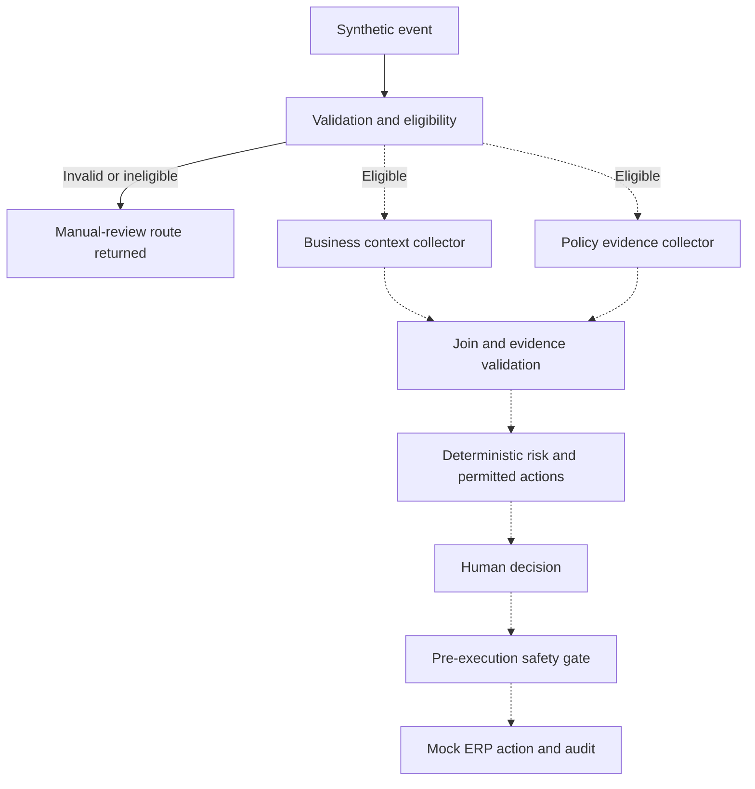

# Agentic Order Exception Workflow

An enterprise AI proof of concept under active development for reviewing credit-blocked B2B sales orders.

**Status: early-stage prototype.** Implemented today: input validation, deterministic eligibility, three synthetic scenarios, a readable demo and 15 tests. Context collection, retrieval, risk evaluation, human review and execution are designed but not implemented. No LLM, live ERP connection or financial action is included.

## Business problem

A credit block identifies an exception without providing the information needed to resolve it. A reviewer must combine payment history, commercial context, credit policy and contractual restrictions before deciding whether an exception is justified.

The target workflow collects this evidence, calculates risk using explicit rules and prepares a recommendation. An authorised human must approve any action; the system must never autonomously release an order.

## Quick start

Python 3.9 or later. No third-party dependencies or API keys.

```bash
git clone https://github.com/annadiakonu/agentic-order-exception-workflow
cd agentic-order-exception-workflow

PYTHONPATH=src python3 -m order_exception                 # run the demo
PYTHONPATH=src python3 -m unittest discover -s tests -v   # run the tests
```

Add `--json` to the demo command to print the raw result objects.

## Example run

The eligibility gate answers one question: may this blocked order enter analysis? An order is admitted only if the block is credit-related, the value is EUR 50,000–250,000 inclusive, and the hard-stop flag is explicitly `false`. Admission is not approval.

Real output of `PYTHONPATH=src python3 -m order_exception` on the three synthetic orders in `data/blocked_orders.json`:

```text
Eligibility gate - 3 synthetic blocked orders

Order ORD-DEMO-001  |  customer CUST-DEMO-001
  Block reason : credit_limit_exceeded
  Order value  : EUR 120,000
  Hard stop    : no
  Checks       : [ok] credit block   [ok] value EUR 50k-250k   [ok] no hard stop
  Result       : ADMITTED FOR ANALYSIS  (next step: collect_context)
  Why          : All three entry conditions pass. This is not an approval; a human reviews every case.

Order ORD-DEMO-002  |  customer CUST-DEMO-002
  Block reason : credit_exposure_exceeded
  Order value  : EUR 180,000
  Hard stop    : yes
  Checks       : [ok] credit block   [ok] value EUR 50k-250k   [x] no hard stop
  Result       : MANUAL REVIEW  (next step: manual_review)
  Why          : A hard stop is set. It must be investigated, never bypassed.

Order ORD-DEMO-003  |  customer CUST-DEMO-003
  Block reason : credit_limit_exceeded
  Order value  : EUR 160,000
  Hard stop    : unknown (null)
  Checks       : not run - input validation failed
  Result       : INPUT INVALID -> MANUAL REVIEW  (next step: manual_review)
  Why          : Hard-stop status is unknown. Unknown is never treated as 'no'.
```

The three outcomes map to the result contract: `completed / eligible=true`, `completed / eligible=false` and `failed / eligible=null`. The CLI returns route labels; it does not yet invoke collectors or a manual-review service.

## Tests

```bash
PYTHONPATH=src python3 -m unittest discover -s tests -v
```

```text
Ran 15 tests in 0.002s

OK
```

The tests cover the inclusive EUR 50k/250k boundaries, both credit block reasons, hard-stop handling, unknown or coerced values (`null`, `"false"`, `0`, `NaN`, `True`), unsupported currency, missing identifiers, preservation of every failure reason, and that the demo output never presents admission as approval.

## Architecture

Solid arrows describe the implemented eligibility path. Dotted arrows describe planned transitions.



[Full decision flow](docs/decision-flow.md) includes failures, information requests and execution reconciliation.

## Design principles

- Keep eligibility, risk, authority and execution checks deterministic.
- Treat missing facts as unknown; never substitute favourable defaults.
- Constrain actions by the intersection of credit policy and contract permissions.
- Bind approval to the assessed facts; material changes require reassessment.
- Use LLMs only for evidence assistance and explanations, with validated outputs.
- Preserve source evidence, decisions and execution outcomes in a case audit trail.

Only the eligibility controls are enforced by the current code.

## Technology and structure

Python standard library: `dataclasses`, `decimal`, `json` and `unittest`. LangGraph, retrieval storage, an LLM provider and a review interface are future choices, not dependencies.

| Path | Purpose |
| --- | --- |
| `src/order_exception/eligibility.py` | Implemented validation and eligibility rules |
| `src/order_exception/__main__.py` | Synthetic demo with readable and `--json` output |
| `data/blocked_orders.json` | Three synthetic ERP events |
| `tests/test_eligibility.py` | Boundary and invalid-input tests |
| `tests/test_demo.py` | Demo output never overclaims a decision |
| [Architecture](docs/architecture.md) | Components, interfaces and implementation status |
| [Decision flow](docs/decision-flow.md) | End-to-end target workflow |
| [Guardrails](docs/guardrails.md) | Controls, enforcement and failure behaviour |
| [Architecture decisions](docs/decisions.md) | Trade-offs and open decisions |
| [State contract](docs/state-contract.md) | Current results and target case lifecycle |

## Next implementation increments

1. Validated synthetic ERP/CRM context and deterministic risk tests.
2. Versioned synthetic policy, contract and SOP evidence; permitted-action intersection.
3. Case orchestration, simulated human review and approval invalidation.
4. Mock execution, idempotency, reconciliation and audit scenarios.
5. Optional retrieval and LLM integration, evaluated against the offline baseline.

## Limitations

This is not yet an end-to-end agentic demo. There is no persistent case registry, deduplication, RAG, LLM integration, reviewer authentication, approval service, execution adapter or audit store. The CLI expects a trusted fixture containing event objects; it is not a hardened ingestion endpoint.

All data and thresholds are illustrative. No production readiness, recovered revenue or measured efficiency gains are claimed.

## License

[MIT](LICENSE) © 2026 Anna Diakonu
