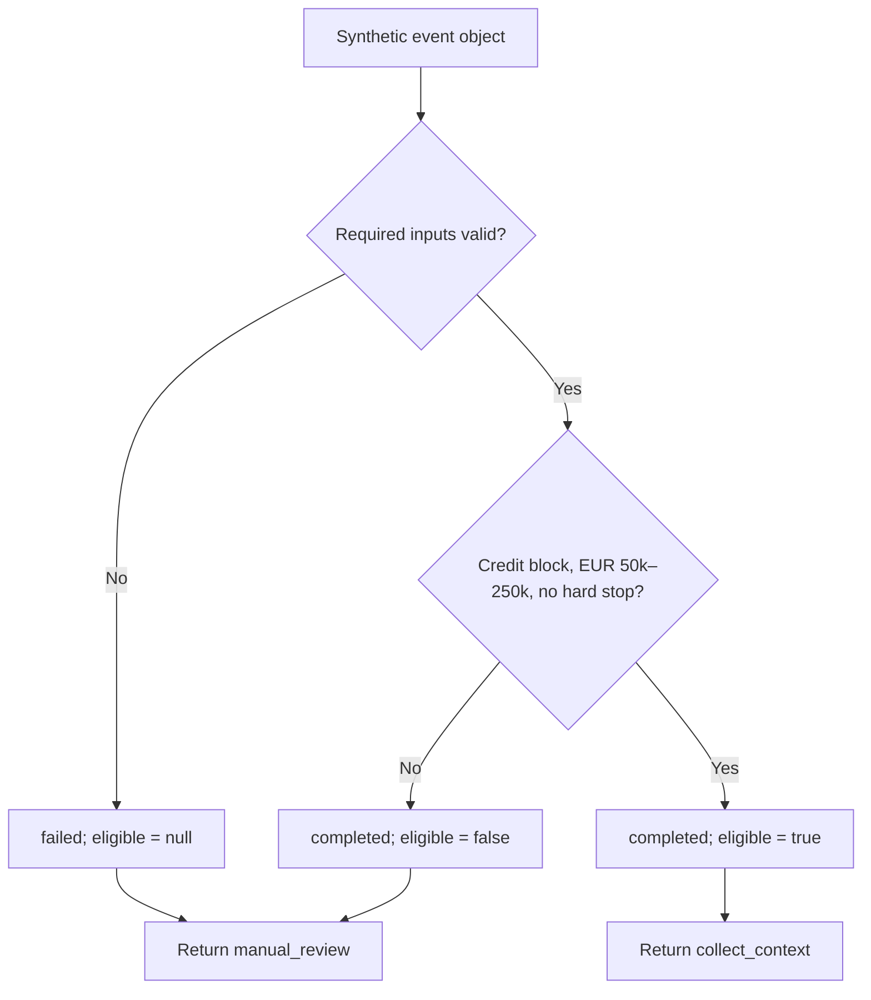
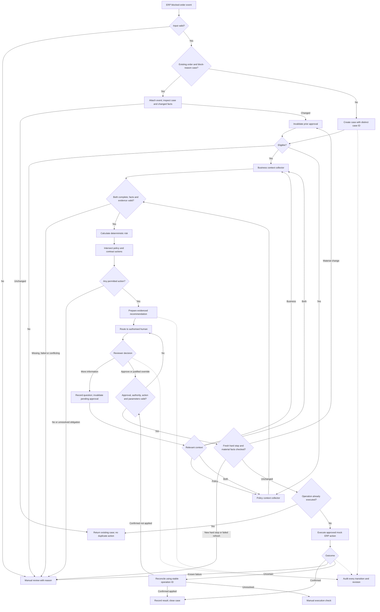

# Decision flow

## Current executable path

The CLI passes each fixture object to the eligibility function and prints its result. It does not create cases or execute the returned route.

## Target end-to-end workflow

Everything below is planned except the validation and eligibility rules. The ingestion and manual-review services are not implemented.

Audit arrows illustrate the cross-cutting requirement; all transitions, failures and retries must be recorded, not only the four shown.

## Risk rules

Evaluate only complete, valid facts. High triggers take precedence.

| Risk | Rule | Default reviewer |
| --- | --- | --- |
| High | Any: payment rate <90%; exceedance >EUR 75,000; overdue >30 days; critical escalation | Senior Credit Manager |
| Low | All: payment rate >=97%; exceedance <=EUR 25,000; overdue <=7 days; Strategic tier; no critical escalation | Credit Analyst |
| Medium | Every other valid case | Credit Manager |

Overdue amount is a required context fact but is not a risk threshold in this design. Missing facts must not become Medium by default.

A senior reviewer may handle lower levels, subject to assignment. Overrides require justification and cannot exceed policy, contract or authority limits. Keep blocked is a conservative recommendation only when permitted and no unresolved obligation requires escalation.
